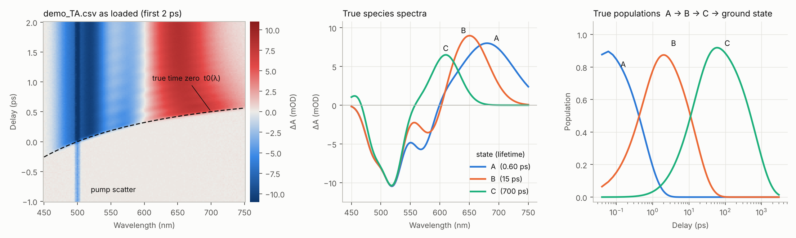

# TRSpecAnalyzer

[](https://doi.org/10.5281/zenodo.24420777)

An app for analyzing time-resolved spectroscopy data: transient
absorption (fs/ns TA), time-resolved photoluminescence, time-resolved
Raman and IR, or any other signal measured as a delay x wavelength matrix.

Loading, corrections, fitting and decomposition are done in one program.
It is available in two versions with the same functions:

- **MATLAB**: a single file, `TRSpecAnalyzer.m`
- **Python**: the folder [`python`](python); it runs without MATLAB



*The first demo data set (`demo/demo_TA.csv`, synthetic) and the answer the
analysis should recover.*

## Requirements

- MATLAB version: MATLAB R2020b or later, no additional toolboxes
- Python version: Python 3.10 or later (3.13 recommended) on Windows or
  macOS. The install script downloads the packages it needs (numpy, scipy,
  matplotlib, PySide6)

## Getting started with the MATLAB version

1. Download `TRSpecAnalyzer.m` (or clone this repository) and put it in a
   folder on the MATLAB path.
2. In MATLAB, run

   ```matlab
   TRSpecAnalyzer
   ```

3. Press `Load...` and open `demo/demo_TA.csv`. Then either follow the
   walkthrough in [`demo/README_demo.txt`](demo/README_demo.txt), or press
   `Auto Analysis...` and `Run` for a first overview.

## Getting started with the Python version

1. Download the file `TRSpecAnalyzer_python_v<version>.zip` attached to the
   [latest release](https://github.com/woojae-collab/TRSpecAnalyzer/releases/latest)
   and unpack it. It holds the program and the demo data. (In a clone of
   this repository the program is in the folder `python` and the demo data
   in `demo`.)
2. Install Python 3.13 from [python.org](https://www.python.org/downloads/).
3. Windows: double-click `install_windows.bat` once, then start the program
   with `run_windows.bat`. macOS: `install_mac.command` once, then
   `run_mac.command` (the two macOS files have not been tried on a Mac yet).

[`python/README.txt`](python/README.txt)
([한국어](python/README_KO.txt)) has the details: updating, the mouse
actions in the plots, the differences from the MATLAB version, and how the
two versions were compared. The user manuals below describe the windows of
both versions.

## Data format

Text files (CSV / DAT / TXT; comma, tab or space delimited):

```
corner , t1 , t2 , ... , tN        first row    : delay times
l1     , signal matrix (M x N)     first column : wavelength or wavenumber
...
lM     ,
```

Several scans of the same measurement can be loaded together, inspected
and averaged.

## What it does

**Data handling**

- Load one file, or load and average several scans with per-file quality
  check, outlier detection and time-shift alignment
- Background subtraction, time-zero shift, chirp correction, cropping, and
  masking of wavelength ranges (for example pump scatter)
- Subtraction of a measurement of the solvent or substrate alone, with
  scale and time shift typed or estimated
- Anisotropy from measurements with parallel and perpendicular
  polarization: parallel, perpendicular, magic-angle and r(λ, t) views,
  each of which can be analyzed and keeps its own results; G typed or
  from tail matching, with a plot of G along the spectrum as a check; a
  time shift of the perpendicular data, typed or estimated, for
  measurements whose time zero differs
- Conversion ΔA ↔ ΔT/T for transient absorption
- Time unit fs / ps / ns / us; spectral axis in nm or cm-1
- Sessions: the whole working state, including every result, is saved to
  and restored from one file (`.mat` in the MATLAB version, `.trsession`
  in the Python version)

**Analysis**

- Single-wavelength fit: sum of exponentials (optionally stretched)
  convolved with a Gaussian IRF; also for a band of wavelengths (its
  integral over the spectral axis, or its mean)
- SVD
- Global Analysis: DADS and EADS, with 1-sigma uncertainties of the fitted
  parameters and optional coherent-artifact terms at time zero
- Target Analysis: a compartment model of your own, written as text
  (`A -> B`, `A <-> B : kf, kb`, `B -> GS`), with shared, tied, fixed or
  limited rate constants and spectral constraints (zero ranges, equal
  spectra, non-negative spectra). Parameters that the data do not
  determine are flagged
- Lifetime Density Analysis (LDA)
- MCR-ALS
- Coherence analysis of the residual oscillations and time-frequency maps;
  the vibrational coherence of the solvent, measured alone, can be
  subtracted first, with the maps before and after side by side; the
  main window then offers views of the data without the solvent
  oscillation or without the whole solvent signal (for a 2D map
  without the solvent)
- Band position: where a band lies at every delay (spectral shift,
  dynamic Stokes shift), by its first moment, by a parabola through its
  top or by a log-normal fit; the position is fitted with a sum of
  exponentials and shown as C(t)
- Auto Analysis: proposes the corrections and the number of components and
  writes a report that lists every decision with the numbers behind it

Corrected data and analysis results can be exported as CSV files.

## Documentation

| | PDF | Word |
|---|---|---|
| User manual (English) | [PDF](docs/TRSpecAnalyzer_User_Manual_EN.pdf) | [docx](docs/TRSpecAnalyzer_User_Manual_EN.docx) |
| 사용 설명서 (한국어) | [PDF](docs/TRSpecAnalyzer_User_Manual_KO.pdf) | [docx](docs/TRSpecAnalyzer_User_Manual_KO.docx) |

## Demo data

The [`demo`](demo) folder holds six synthetic data sets with known
answers, the true spectra and populations they were made from, and the
script that generated them (`make_demo_data.m`). Nothing in it is a
measurement.

| File | Kinetics | Used for |
|---|---|---|
| `demo_TA.csv` (+ `scans/`) | A -> B -> C -> ground state, with chirp, background, pump scatter and oscillations | the full walkthrough, Load & Average, Auto Analysis |
| `demo_target.csv` | A -> B and A -> C in parallel, B -> ground state, C -> ground state | Target Analysis of a model that a sequential fit cannot describe |
| `demo_equilibrium.csv` | A <-> B, B -> C -> ground state | Target Analysis with a step that runs in both directions |
| `demo_solution.csv` + `demo_solvent.csv` | a solute in cyclohexane and cyclohexane alone, 20 fs pulses: solvent oscillations and a coherent artifact | removing the solvent coherence in the Coherence window, the solvent views of the main window, `Subtract data...` |
| `demo_solution_raw.csv` + `demo_solvent_raw.csv` | the same pair as measured: background and chirp | correcting the solution data and letting the solvent data follow |
| `demo_aniso_par.csv` + `demo_aniso_perp.csv` | one sample measured with parallel and perpendicular polarization, rotation in 50 ps | `Anisotropy...`: G from tail matching, r(t), magic-angle data |
| `demo_aniso_raw_par.csv` + `demo_aniso_raw_perp.csv` | the same pair as measured: background, pump scatter and chirp | correcting the parallel data and letting the perpendicular data follow |
| `demo_aniso_raw_perp_late.csv` | the perpendicular measurement once more, its time zero 0.05 ps late | `Anisotropy...`: `Estimate` finds the time shift, −0.050 ps |
| `demo_solvation.csv` | time-resolved emission of a dye whose band shifts to the red while the solvent relaxes (dynamic Stokes shift); one decay of 4 ns | loading intensity data, `Fit trace...` on a band against one wavelength, `Band position...`: the shift itself, with its three times |

`demo/README_demo.txt` gives the steps and the numbers to expect at each
one, so the program can be checked on your own installation.

## Versions

The version number (major.minor.patch) is shown in the title of the main
window and returned by `TRSpecAnalyzer.Version`. It is also written into
saved sessions and Auto Analysis reports. Changes are listed in
[CHANGELOG.md](CHANGELOG.md), and the released versions stay available
under [Releases](https://github.com/woojae-collab/TRSpecAnalyzer/releases).
The Python version carries the number of the MATLAB version whose
functions it has. When you report results, please state the version you
used.

## 한국어 안내

TRSpecAnalyzer는 시간분해 분광 데이터(TA, TR-PL, TR-Raman, TR-IR)를
불러와 보정하고, 피팅과 분해 분석까지 한 프로그램에서 수행하는 MATLAB
도구입니다. `TRSpecAnalyzer.m` 파일 하나만 있으면 되고, MATLAB R2020b
이상에서 추가 toolbox 없이 실행됩니다. 자세한 사용법은
[한국어 사용 설명서](docs/TRSpecAnalyzer_User_Manual_KO.pdf)를 보세요.

MATLAB 없이 쓸 수 있는 Python판도 `python` 폴더에 있습니다. 기능은 MATLAB판과
같고, 설치와 사용법은 [Python판 안내](python/README_KO.txt)에 있습니다.

## Feedback

Questions and bug reports are welcome under *Issues*. For a bug report,
the text of the error dialog and, if possible, a small data file that
reproduces the problem help most.

## References

The methods of the program are established ones. The publications they
rest on are listed, part by part, in [REFERENCES.md](REFERENCES.md).

## How to cite

If TRSpecAnalyzer was useful for your work, please cite it and state the
version you used:

> Kim, W. TRSpecAnalyzer: an app for the analysis of time-resolved
> spectroscopy data (MATLAB and Python versions). Zenodo.
> https://doi.org/10.5281/zenodo.24420777

This DOI stands for all versions and always resolves to the latest one.
Every version also has a DOI of its own, listed on the Zenodo page.

## Author

Woojae Kim, ULS Lab, Department of Chemistry, Yonsei University.
The code was written with Claude Code.

## License

MIT License. See [LICENSE](LICENSE).
